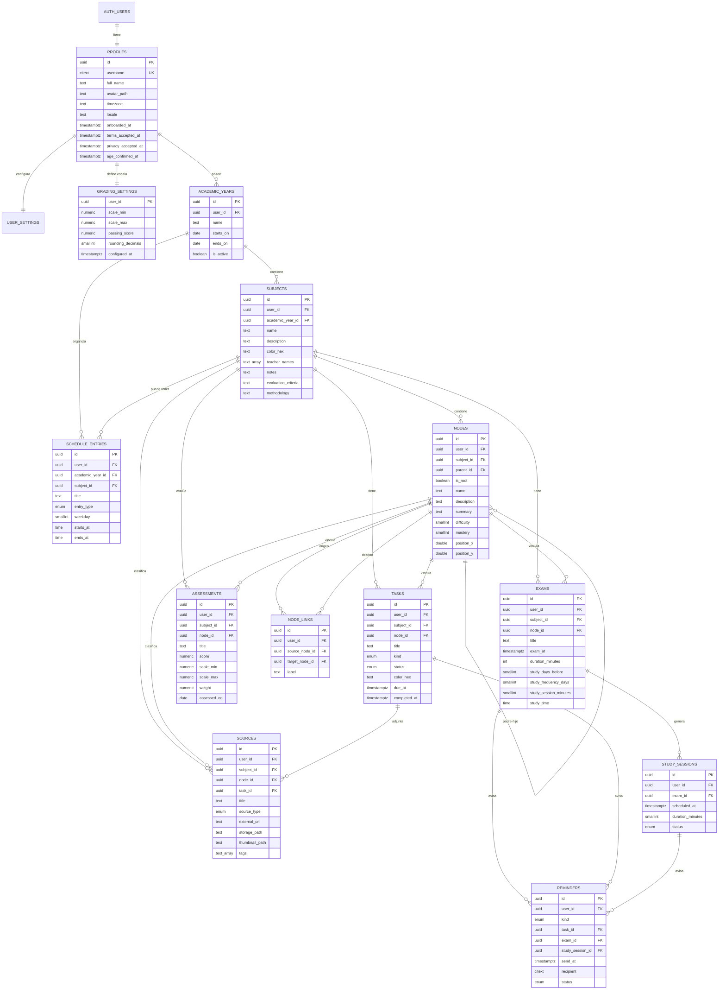

# Syntropy — Modelo de datos

**Fase:** 1 — Diseño / implementación de Fase 2  
**Estado:** aprobada; migraciones aplicadas y verificadas en Supabase real el 11 de noviembre de 2026, con pruebas de aislamiento pendientes de completar con dos cuentas
**Motor:** PostgreSQL 15+ en Supabase  
**Migraciones:** [`001_schema_inicial.sql`](../../supabase/migrations/001_schema_inicial.sql) y [`002_ajustes_fase2.sql`](../../supabase/migrations/002_ajustes_fase2.sql)

> **Estado de validación:** la estructura, las restricciones, el trigger de registro, las políticas RLS y las funciones RPC de la Fase 2 se probaron localmente con PostgreSQL 17 embebido (PGlite) el 10 de noviembre de 2026. El 11 de noviembre de 2026 se aplicaron las dos migraciones en el proyecto real de Supabase y se ejecutaron flujos E2E de registro, confirmación, perfil, avatar, años, asignaturas, contraseña y borrado de cuenta. La prueba de aislamiento entre dos cuentas y el enlace de recuperación por correo quedaron pendientes por el límite de envío de correo de Supabase. El detalle está en la sección 14 y en [`docs/fase-2/README.md`](../fase-2/README.md).

---

## 1. Convenciones

- Claves primarias `uuid` con `gen_random_uuid()`.
- Nombres de tablas y columnas en `snake_case`.
- Fechas y horas en `timestamptz` (UTC) salvo el horario semanal, que usa día + hora local.
- Dinero no aplica; no hay campos monetarios.
- Colores en formato `#RRGGBB`, validados con `check`.
- Enums de PostgreSQL para estados estables.
- `created_at` y `updated_at` en todas las tablas editables.
- `user_id` desnormalizado en todas las tablas para simplificar RLS y permitir claves compuestas por usuario.
- Borrado en cascada controlado; las fuentes no se borran accidentalmente al eliminar un nodo.
- El perfil se crea automáticamente con un trigger al confirmar el registro.

---

## 2. Diagrama entidad-relación



---

## 3. Entidades

### 3.1. `profiles`

Datos públicos dentro de la cuenta. No hay perfiles públicos: solo el dueño puede leerlos.

| Campo | Tipo | Nulo | Regla |
|---|---|---|---|
| `id` | `uuid` | No | PK, referencia `auth.users(id)` |
| `username` | `citext` | No | Único, 3–30 caracteres, letras/números/guión bajo |
| `full_name` | `text` | Sí | Nombre visible |
| `avatar_path` | `text` | Sí | Ruta en bucket `avatars` |
| `timezone` | `text` | No | Zona IANA, por ejemplo `America/Argentina/Buenos_Aires` |
| `locale` | `text` | No | Por defecto `es` |
| `onboarded_at` | `timestamptz` | Sí | Marca de bienvenida completada |
| `terms_accepted_at` | `timestamptz` | Sí | Aceptación de términos (D8) |
| `privacy_accepted_at` | `timestamptz` | Sí | Aceptación de privacidad (D8) |
| `age_confirmed_at` | `timestamptz` | Sí | Confirmación de edad 13+ (D8); no se guarda fecha de nacimiento |
| `created_at` | `timestamptz` | No | — |
| `updated_at` | `timestamptz` | No | — |

**Notas:**

- `citext` permite que “Martina” y “martina” no puedan existir a la vez.
- El nombre de usuario no se muestra a otros usuarios; no hay funciones sociales.
- El correo vive en `auth.users`, no en `profiles`.
- El trigger de registro crea el perfil con el nombre de usuario enviado en metadatos y, si está ocupado, agrega un sufijo numérico.
- Los tres consentimientos son opcionales en conjunto (usuarios históricos), pero la restricción `profiles_consents_all_or_none` exige que estén todos o ninguno. El registro de la app no permite crear una cuenta sin los tres.

### 3.2. `user_settings`

| Campo | Tipo | Nulo | Regla |
|---|---|---|---|
| `user_id` | `uuid` | No | PK, referencia `profiles` |
| `week_starts_on` | `smallint` | No | Fijo en 1 (lunes) en el MVP |
| `theme` | `text` | No | `dark` por defecto; `light` futuro |
| `email_reminders_enabled` | `boolean` | No | Falso por defecto |
| `reminder_email` | `citext` | Sí | Si es nulo se usa el correo de Auth |
| `default_reminder_minutes` | `integer` | No | 1440 (24 h) por defecto |
| `created_at` / `updated_at` | `timestamptz` | No | — |

### 3.3. `grading_settings`

Configuración global de calificaciones del usuario. En el futuro podrá haber una configuración por asignatura.

| Campo | Tipo | Nulo | Regla |
|---|---|---|---|
| `user_id` | `uuid` | No | PK |
| `scale_min` | `numeric(6,2)` | No | Por defecto 1 |
| `scale_max` | `numeric(6,2)` | No | Por defecto 10 |
| `passing_score` | `numeric(6,2)` | No | Por defecto 6 |
| `rounding_decimals` | `smallint` | No | 0–4, por defecto 1 |
| `configured_at` | `timestamptz` | Sí | Nulo = el usuario todavía no confirmó la escala |
| `created_at` / `updated_at` | `timestamptz` | No | — |

**Restricciones:**

- `scale_max > scale_min`.
- `passing_score` debe estar entre `scale_min` y `scale_max`.
- La app muestra un aviso de configuración si `configured_at` es nulo.
- Las evaluaciones guardan una copia de su escala; cambiar la escala global no reinterpreta notas viejas.

### 3.4. `academic_years`

Representa un ciclo académico: por ejemplo “5.º año · 2026” o “Universidad · 2026”.

| Campo | Tipo | Nulo | Regla |
|---|---|---|---|
| `id` | `uuid` | No | PK |
| `user_id` | `uuid` | No | Dueño |
| `name` | `text` | No | 1–80 caracteres |
| `starts_on` | `date` | No | Inicio |
| `ends_on` | `date` | No | Fin, posterior al inicio |
| `is_active` | `boolean` | No | Solo uno activo por usuario |
| `created_at` / `updated_at` | `timestamptz` | No | — |

**Índice único parcial:** un solo año activo por usuario.

**Decisión pendiente:** si “Año de curso” debe ser un nivel (“5.º año”) o un ciclo calendario (“2026”). La propuesta admite ambos en el nombre.

### 3.5. `subjects`

| Campo | Tipo | Nulo | Regla |
|---|---|---|---|
| `id` | `uuid` | No | PK |
| `user_id` | `uuid` | No | Dueño |
| `academic_year_id` | `uuid` | No | Año al que pertenece |
| `name` | `text` | No | 1–80 caracteres |
| `description` | `text` | Sí | Descripción breve |
| `color_hex` | `text` | No | `#RRGGBB` de la paleta |
| `teacher_names` | `text[]` | No | Lista de nombres, máximo 20 |
| `notes` | `text` | Sí | Anotaciones importantes |
| `evaluation_criteria` | `text` | Sí | Criterios de evaluación |
| `methodology` | `text` | Sí | Metodología de trabajo |
| `created_at` / `updated_at` | `timestamptz` | No | — |

**Reglas:**

- No se permiten dos asignaturas con el mismo nombre (sin distinguir mayúsculas) dentro del mismo año.
- El color se elige de la paleta; se guarda el hex para que no dependa de la interfaz.
- Los docentes se guardan como arreglo de nombres en el MVP. No hay entidad `teachers` porque el alcance solo pide mostrarlos. Se puede normalizar en una versión futura.
- Eliminar una asignatura elimina en cascada sus tareas, exámenes, evaluaciones, nodos, bloques de horario y fuentes. La interfaz debe pedir confirmación explícita.

### 3.6. `schedule_entries`

Un bloque semanal. Puede ser clase, descanso, actividad secundaria u otro.

| Campo | Tipo | Nulo | Regla |
|---|---|---|---|
| `id` | `uuid` | No | PK |
| `user_id` | `uuid` | No | Dueño |
| `academic_year_id` | `uuid` | No | Año |
| `subject_id` | `uuid` | Sí | Obligatorio si es clase; opcional para actividades |
| `title` | `text` | No | Nombre del bloque |
| `entry_type` | enum | No | `class`, `break`, `activity`, `other` |
| `weekday` | `smallint` | No | 1 = lunes … 7 = domingo |
| `starts_at` | `time` | No | Hora local |
| `ends_at` | `time` | No | Posterior a `starts_at` |
| `location` | `text` | Sí | Aula, enlace, lugar |
| `notes` | `text` | Sí | — |
| `created_at` / `updated_at` | `timestamptz` | No | — |

**Reglas:**

- `entry_type = 'class'` exige `subject_id`.
- Un descanso o actividad puede no tener asignatura.
- Los bloques creados desde una asignatura aparecen en el horario general.
- No se modelan excepciones por fecha en el MVP (feriados, clases canceladas). Se puede agregar `schedule_exceptions` en una versión posterior.
- Las horas son locales; la zona horaria se toma del perfil.

### 3.7. `tasks`

| Campo | Tipo | Nulo | Regla |
|---|---|---|---|
| `id` | `uuid` | No | PK |
| `user_id` | `uuid` | No | Dueño |
| `subject_id` | `uuid` | No | Asignatura |
| `node_id` | `uuid` | Sí | Tema vinculado, futuro |
| `title` | `text` | No | 1–160 caracteres |
| `description` | `text` | Sí | — |
| `kind` | enum | No | `task` o `project` |
| `status` | enum | No | `pending`, `waiting`, `done` |
| `color_hex` | `text` | Sí | Color propio; si es nulo se usa el de la asignatura |
| `due_at` | `timestamptz` | No | Fecha y hora límite |
| `completed_at` | `timestamptz` | Sí | Obligatorio si está terminada |
| `created_at` / `updated_at` | `timestamptz` | No | — |

**Reglas:**

- En el calendario general se usa siempre el color de la asignatura.
- En el calendario individual se usa `color_hex` si existe; si no, el de la asignatura.
- `completed_at` se completa al pasar a `done` y se limpia al volver a otro estado.
- Una tarea puede vincularse a un nodo de su misma asignatura.
- Si se elimina el nodo, la tarea queda sin nodo, pero no se borra.

### 3.8. `exams`

| Campo | Tipo | Nulo | Regla |
|---|---|---|---|
| `id` | `uuid` | No | PK |
| `user_id` | `uuid` | No | Dueño |
| `subject_id` | `uuid` | No | Asignatura |
| `node_id` | `uuid` | Sí | Tema vinculado |
| `title` | `text` | No | 1–160 caracteres |
| `description` | `text` | Sí | — |
| `exam_at` | `timestamptz` | No | Fecha y hora |
| `duration_minutes` | `integer` | Sí | 1–1440 |
| `location` | `text` | Sí | Aula, enlace |
| `study_days_before` | `smallint` | Sí | 0–365 |
| `study_frequency_days` | `smallint` | Sí | 1–30 |
| `study_session_minutes` | `smallint` | Sí | 5–480 |
| `study_time` | `time` | Sí | Hora local preferida para estudiar |
| `created_at` / `updated_at` | `timestamptz` | No | — |

**Reglas del plan de estudio:**

- Los cuatro campos del plan deben estar todos completos o todos vacíos.
- `study_time` es necesario para ubicar las sesiones en el calendario. Se propone 18:00 por defecto en la interfaz, editable.
- Las sesiones se generan en la zona horaria del perfil.
- Si el plan cambia, se eliminan las sesiones futuras en estado `scheduled` y se regeneran; las completadas o salteadas se conservan.
- Si la fecha de inicio calculada ya pasó, se empieza hoy (si aún hay tiempo antes del examen).

### 3.9. `study_sessions`

| Campo | Tipo | Nulo | Regla |
|---|---|---|---|
| `id` | `uuid` | No | PK |
| `user_id` | `uuid` | No | Dueño |
| `exam_id` | `uuid` | No | Examen |
| `scheduled_at` | `timestamptz` | No | Fecha y hora |
| `duration_minutes` | `smallint` | No | 5–480 |
| `status` | enum | No | `scheduled`, `completed`, `skipped` |
| `created_at` / `updated_at` | `timestamptz` | No | — |

**Reglas:**

- Se generan a partir del plan del examen.
- Se muestran en el calendario individual de la asignatura, con estilo “Estudio”.
- No se muestran en el calendario general en el MVP.
- El usuario puede marcarlas como completadas o salteadas.
- No se solapan automáticamente con otras tareas; la interfaz advierte si hay conflicto.

### 3.10. `assessments`

| Campo | Tipo | Nulo | Regla |
|---|---|---|---|
| `id` | `uuid` | No | PK |
| `user_id` | `uuid` | No | Dueño |
| `subject_id` | `uuid` | No | Asignatura |
| `node_id` | `uuid` | Sí | Tema vinculado |
| `title` | `text` | No | 1–160 caracteres |
| `score` | `numeric(7,2)` | Sí | Nulo = evaluación futura o sin corregir |
| `scale_min` | `numeric(6,2)` | No | Copia de la escala al crear |
| `scale_max` | `numeric(6,2)` | No | Copia de la escala al crear |
| `weight` | `numeric(7,2)` | No | Mayor que 0 |
| `assessed_on` | `date` | Sí | Fecha de la evaluación |
| `notes` | `text` | Sí | — |
| `created_at` / `updated_at` | `timestamptz` | No | — |

**Reglas:**

- `score` debe estar entre `scale_min` y `scale_max` cuando no es nulo.
- La escala se guarda por evaluación para que un cambio futuro no altere notas históricas.
- `weight` es relativo: no es obligatorio que los pesos sumen 100. El promedio se normaliza por la suma de pesos de las evaluaciones con nota.
- Las evaluaciones sin nota no afectan el promedio actual, pero sí la proyección si se usan como “próxima evaluación”.
- No se modelan categorías (Exámenes 40 %, Trabajos 60 %) en el MVP. Se puede agregar `assessment_categories` en una versión posterior.

### 3.11. `nodes`

| Campo | Tipo | Nulo | Regla |
|---|---|---|---|
| `id` | `uuid` | No | PK |
| `user_id` | `uuid` | No | Dueño |
| `subject_id` | `uuid` | No | Asignatura |
| `parent_id` | `uuid` | Sí | Padre en el árbol |
| `is_root` | `boolean` | No | Nodo raíz de la asignatura |
| `name` | `text` | No | 1–120 caracteres |
| `description` | `text` | Sí | — |
| `summary` | `text` | Sí | Resumen tipo mapa conceptual |
| `difficulty` | `smallint` | Sí | 1–10; nulo solo en el nodo raíz |
| `mastery` | `smallint` | Sí | 1–10; nulo solo en el nodo raíz |
| `position_x` | `double precision` | No | Posición en el lienzo |
| `position_y` | `double precision` | No | Posición en el lienzo |
| `created_at` / `updated_at` | `timestamptz` | No | — |

**Reglas:**

- Un solo nodo raíz por asignatura.
- El nodo raíz no tiene padre, dificultad, dominio ni contorno.
- Los nodos de tema tienen padre y dificultad/dominio obligatorios.
- La jerarquía máxima es: raíz → principal → secundario → terciario (3 niveles de temas).
- El padre debe pertenecer a la misma asignatura.
- Eliminar un nodo elimina su subárbol. La interfaz debe advertir cuántos temas se borrarán.
- Las tareas, exámenes y evaluaciones vinculados quedan sin nodo; las fuentes se bloquean (ver `sources`).
- La posición se guarda para conservar el diseño del mapa.

**Nota:** la decisión del nodo raíz está pendiente (D5). Si se decide que el nodo raíz sea un tema evaluable, cambian estas restricciones.

### 3.12. `node_links`

Conexiones libres entre nodos, incluso de asignaturas distintas.

| Campo | Tipo | Nulo | Regla |
|---|---|---|---|
| `id` | `uuid` | No | PK |
| `user_id` | `uuid` | No | Dueño |
| `source_node_id` | `uuid` | No | Nodo origen |
| `target_node_id` | `uuid` | No | Nodo destino |
| `label` | `text` | Sí | Texto de la relación |
| `created_at` | `timestamptz` | No | — |

**Reglas:**

- Origen y destino deben ser distintos.
- Ambos nodos deben pertenecer al usuario.
- Se permite conectar nodos de asignaturas diferentes.
- No se permiten enlaces duplicados entre el mismo par, sin importar el orden.
- No reemplaza la relación padre-hijo; es una relación transversal.

### 3.13. `sources`

| Campo | Tipo | Nulo | Regla |
|---|---|---|---|
| `id` | `uuid` | No | PK |
| `user_id` | `uuid` | No | Dueño |
| `subject_id` | `uuid` | No | Asignatura |
| `node_id` | `uuid` | Sí | Tema o nodo; `NULL` representa «Sin tema» (D7) |
| `task_id` | `uuid` | Sí | Tarea relacionada |
| `title` | `text` | No | 1–200 caracteres |
| `description` | `text` | Sí | — |
| `source_type` | enum | No | `document`, `book`, `link`, `video`, `image`, `audio`, `other` |
| `external_url` | `text` | Sí | Enlace externo |
| `storage_path` | `text` | Sí | Archivo en Storage |
| `thumbnail_path` | `text` | Sí | Miniatura |
| `tags` | `text[]` | No | Máximo 20 |
| `created_at` / `updated_at` | `timestamptz` | No | — |

**Reglas:**

- Debe existir `external_url` o `storage_path`; no ambos obligatoriamente.
- Si `node_id` no es nulo, el nodo debe pertenecer a la asignatura indicada.
- La tarea, si existe, debe pertenecer a la misma asignatura.
- Si se elimina el nodo, la operación se bloquea mientras tenga fuentes; el usuario debe reasignarlas. Esto evita perder archivos.
- Si se elimina la tarea, la fuente se conserva con `task_id = NULL`.
- La biblioteca es Fase 6. La tabla se crea desde el inicio para no migrar después.

**Decisión D7 aplicada:** el nodo es opcional. La migración `002_ajustes_fase2.sql` elimina el `NOT NULL` de `node_id`; una fuente sin tema sigue perteneciendo obligatoriamente a una asignatura.

### 3.14. `reminders`

| Campo | Tipo | Nulo | Regla |
|---|---|---|---|
| `id` | `uuid` | No | PK |
| `user_id` | `uuid` | No | Dueño |
| `kind` | enum | No | `task_due`, `exam`, `study_session`, `custom` |
| `task_id` | `uuid` | Sí | Según el tipo |
| `exam_id` | `uuid` | Sí | Según el tipo |
| `study_session_id` | `uuid` | Sí | Según el tipo |
| `send_at` | `timestamptz` | No | Fecha de envío |
| `recipient` | `citext` | No | Correo al momento de crear |
| `subject` | `text` | No | Asunto del correo |
| `body` | `text` | Sí | Cuerpo personalizado |
| `status` | enum | No | `scheduled`, `sent`, `failed`, `cancelled` |
| `provider_message_id` | `text` | Sí | ID de Resend |
| `sent_at` | `timestamptz` | Sí | — |
| `error_message` | `text` | Sí | Solo para diagnóstico |
| `created_at` / `updated_at` | `timestamptz` | No | — |

**Reglas:**

- Cada tipo apunta a una sola entidad.
- `custom` no apunta a ninguna.
- Los recordatorios se procesan desde una Edge Function con `service_role`; el cliente no necesita permiso para enviar correos.
- La dirección se guarda como copia; si el usuario cambia de correo, los recordatorios futuros se recalculan.
- Fase 7.

---

## 4. Relaciones y claves

### 4.1. Claves compuestas por usuario

Además de `id`, las tablas padre exponen una clave única `(id, user_id)` o `(id, subject_id, user_id)`. Las tablas hijas usan claves foráneas compuestas:

```sql
subject_id uuid not null,
foreign key (subject_id, user_id)
  references subjects (id, user_id)
```

Esto impide que una fila propia apunte a una asignatura de otra cuenta aunque se conozca el UUID. RLS por sí sola no protege una clave foránea.

### 4.2. Relaciones principales

| Relación | Cardinalidad | Borrado |
|---|---|---|
| `profiles` → `academic_years` | 1:N | Cascada |
| `academic_years` → `subjects` | 1:N | Cascada |
| `subjects` → `tasks` | 1:N | Cascada |
| `subjects` → `exams` | 1:N | Cascada |
| `subjects` → `assessments` | 1:N | Cascada |
| `subjects` → `nodes` | 1:N | Cascada |
| `nodes` → `nodes` | 1:N (padre-hijo) | Cascada en subárbol |
| `nodes` ↔ `nodes` vía `node_links` | N:M | Cascada |
| `exams` → `study_sessions` | 1:N | Cascada |
| `tasks` → `sources` | 1:N opcional | `SET NULL` |
| `subjects` → `sources` | 1:N | Cascada |
| `nodes` → `sources` | 1:N | `RESTRICT` |
| `tasks`/`exams`/`study_sessions` → `reminders` | 1:N | Cascada |

### 4.3. Reglas de integridad adicionales

- Un usuario no puede tener dos años activos.
- Un año no puede tener dos asignaturas con el mismo nombre sin distinguir mayúsculas.
- Una asignatura no puede tener dos nodos raíz.
- Un nodo no puede ser padre de sí mismo.
- Un nodo no puede tener un padre de otra asignatura.
- Un enlace no puede unir un nodo consigo mismo ni duplicar el par.
- Una tarea, examen o evaluación solo puede apuntar a un nodo de su misma asignatura.
- Una fuente solo puede apuntar a un nodo y una tarea de su misma asignatura.
- Una evaluación no puede tener nota fuera de su escala.

---

## 5. Cálculos de calificaciones

### 5.1. Porcentaje de una evaluación

Para una nota `s` en una escala `[min, max]`:

```text
p = (s - min) / (max - min)
porcentaje = p × 100
```

Ejemplos:

| Escala | Nota | Porcentaje |
|---|---|---:|
| 1–10 | 7,0 | 66,67 % |
| 0–20 | 15 | 75 % |
| 0–100 | 82 | 82 % |
| 0–5 | 3,5 | 70 % |

### 5.2. Promedio ponderado

Solo se incluyen evaluaciones con nota. Con pesos `w_i` y porcentajes `p_i`:

```text
P = Σ(w_i × p_i) / Σ(w_i)
promedio = min + (max - min) × P / 100
```

- Los pesos son relativos. No es necesario que sumen 100.
- Si no hay evaluaciones con nota, el promedio no está definido.
- El resultado se redondea solo para mostrar; los cálculos internos conservan precisión.
- Se usa la escala actual para mostrar el promedio. Las evaluaciones conservan su escala original.

### 5.3. Nota necesaria en la próxima evaluación

Objetivo: alcanzar `objetivo` en la escala actual. Próxima evaluación con peso `w_n`.

```text
P_objetivo = (objetivo - min) / (max - min) × 100
P_actual   = Σ(w_i × p_i)
W_actual   = Σ(w_i)
P_necesario = (P_objetivo × (W_actual + w_n) - P_actual) / w_n
nota_necesaria = min + (max - min) × P_necesario / 100
```

Interpretación:

| Resultado | Mensaje |
|---|---|
| `nota_necesaria <= min` | “Ya tienes asegurada la aprobación con el peso restante.” |
| `min < nota_necesaria <= max` | “Necesitas X en la próxima evaluación.” |
| `nota_necesaria > max` | “Con el peso restante no es posible alcanzar la nota mínima.” |
| No hay próxima evaluación | “Agrega una evaluación futura para calcular la proyección.” |

### 5.4. Casos de prueba obligatorios

1. Escala 1–10, pesos 30/20/25/25, notas 7,0 y 8,5.
2. Escala 0–20, nota 15, peso 40.
3. Escala 0–100, nota 82, peso 100.
4. Pesos que no suman 100.
5. Evaluación futura sin nota.
6. Nota necesaria mayor que la máxima.
7. Nota necesaria menor que la mínima.
8. Cambio de escala después de cargar notas.
9. Redondeo a 0, 1 y 2 decimales.
10. Nodo con dos notas de escalas distintas.

### 5.5. Contorno del nodo

- Se toman todas las evaluaciones vinculadas al nodo que tengan nota.
- Cada una se convierte a porcentaje con su propia escala.
- Se calcula el promedio simple de esos porcentajes (no ponderado, según el documento).
- Se aplica la tabla:

| Porcentaje | Nivel |
|---|---|
| 0–29 % | Blanco |
| 30–49 % | Bronce |
| 50–69 % | Plata |
| 70–89 % | Oro |
| 90–99 % | Diamante |
| 100 % | Multicolor |
| Sin notas | Sin calificar (contorno discontinuo) |

---

## 6. Generación del plan de estudio

### 6.1. Entradas

- `exam_at`: fecha y hora del examen.
- `dias_antes`: cuántos días antes empezar.
- `frecuencia`: cada cuántos días estudiar.
- `duracion`: minutos por sesión.
- `hora`: hora local preferida.

### 6.2. Algoritmo

```text
zona = perfil.timezone
fecha_examen = exam_at en zona
inicio = fecha_examen - dias_antes, a la hora elegida
si inicio < ahora: inicio = ahora redondeado a la próxima hora
sesiones = []
fecha = inicio
mientras fecha < fecha_examen:
    agregar sesión(fecha, duracion)
    fecha = fecha + frecuencia días
```

- No se genera una sesión el mismo día del examen si la hora de estudio es posterior al examen.
- Si no cabe ninguna sesión, se muestra un aviso al usuario.
- Si el examen se mueve, se regeneran las sesiones futuras.
- Las sesiones completadas se conservan como historial.

### 6.3. Visualización

- Calendario individual: las sesiones se muestran con borde punteado y etiqueta “Estudio”.
- Calendario general: no se muestran en el MVP.
- Detalle del examen: lista de sesiones generadas, con estado.
- Panel de tareas: las sesiones no son tareas; no se mezclan en los filtros.

---

## 7. Reglas de nodos

### 7.1. Forma

Se deriva de `difficulty`:

```ts
function shapeForDifficulty(d: number) {
  if (d <= 2) return "circle";
  const sides = Math.min(9, d); // 3..9
  return `polygon-${sides}`;
}
```

- Dificultad 1–2: círculo.
- 3: triángulo.
- 4: cuadrado.
- 5: pentágono.
- 6: hexágono.
- 7: heptágono.
- 8: octógono.
- 9–10: eneágono.

### 7.2. Intensidad

```ts
const intensity = 0.18 + ((mastery - 1) / 9) * 0.72; // 0.18 a 0.90
```

- El color base es el de la asignatura.
- Se mezcla con el fondo oscuro.
- El texto se adapta para mantener contraste.

### 7.3. Contorno

- Se calcula con el promedio de porcentajes de las evaluaciones vinculadas.
- Se dibuja fuera del nodo, con separación.
- Sin notas: gris discontinuo.
- El nivel se muestra en el panel de detalle, no solo con color.

### 7.4. Jerarquía

- Nodo raíz: asignatura.
- Nivel 1: temas principales.
- Nivel 2: temas secundarios.
- Nivel 3: temas terciarios.
- No se permiten más niveles en el MVP.
- Las conexiones transversales no crean jerarquía.

---

## 8. Seguridad y RLS

### 8.1. Regla general

Todas las tablas tienen RLS habilitado. Las políticas usan `auth.uid()`.

```sql
create policy "own_rows_select"
on public.tasks for select
to authenticated
using (user_id = auth.uid());

create policy "own_rows_insert"
on public.tasks for insert
to authenticated
with check (user_id = auth.uid());

-- etc. para update y delete
```

### 8.2. Perfil

- `select` y `update` solo del propio perfil.
- No hay `select` público de nombres de usuario.
- El alta la hace un trigger `security definer`.
- El correo no se copia a `profiles`.
- Las aceptaciones D8 se copian en el alta desde metadatos controlados por la app y no se exponen a otros usuarios.

### 8.3. Storage

Buckets privados:

- `academic-files/{user_id}/{source_id}/...`
- `avatars/{user_id}/avatar.webp`

Políticas:

```sql
using (
  bucket_id = 'academic-files'
  and (storage.foldername(name))[1] = auth.uid()::text
)
```

- Descarga con URL firmada.
- No se permite listar archivos de otros usuarios.
- Límite de tamaño y tipos MIME por bucket.

### 8.4. Edge Functions

- Usan `service_role` solo en el servidor.
- Verifican el `user_id` del recordatorio antes de enviar.
- No exponen la clave de Resend.
- Registran el resultado sin guardar contenido sensible.

### 8.5. Pruebas de seguridad

1. Usuario A no puede leer una asignatura de B por ID directo.
2. Usuario A no puede insertar una tarea con `subject_id` de B.
3. Usuario A no puede enlazar nodos de B.
4. Usuario A no puede descargar un archivo de B.
5. Usuario A no puede actualizar el perfil de B.
6. Usuario A no puede ver un recordatorio de B.
7. Un enlace profundo a un ID ajeno devuelve “No encontrado”.

### 8.6. Funciones RPC de Fase 2

- `activate_academic_year(p_year_id uuid)`: `security invoker`. Desactiva el año activo anterior y activa el indicado en una sola transacción. La RLS y el índice único parcial impiden que queden dos años activos.
- `delete_current_user()`: `security definer`, solo para `authenticated`. Elimina la fila de `auth.users` del usuario que llama; las cascadas borran perfil, configuración, años, asignaturas y datos académicos. No acepta un ID externo. La limpieza de archivos de Storage queda pendiente antes de publicar.

Ambas funciones tienen `revoke all` para `public` y `grant execute` solo a `authenticated`.

---

## 9. Índices y rendimiento

| Tabla | Índice | Motivo |
|---|---|---|
| `academic_years` | `(user_id, is_active)` | Año activo |
| `subjects` | `(user_id, academic_year_id)` | Listado |
| `subjects` | `unique (academic_year_id, lower(name))` | Nombres únicos |
| `schedule_entries` | `(user_id, weekday, starts_at)` | Horario |
| `tasks` | `(user_id, due_at)` | Calendario y vencimientos |
| `tasks` | `(user_id, status)` | Filtros |
| `tasks` | `(subject_id, due_at)` | Calendario de materia |
| `exams` | `(user_id, exam_at)` | Próximos exámenes |
| `study_sessions` | `(user_id, scheduled_at)` | Calendario |
| `assessments` | `(subject_id, assessed_on)` | Tabla de notas |
| `nodes` | `(subject_id)` | Árbol |
| `node_links` | `(user_id)` | Plano general |
| `sources` | `(user_id, subject_id)` | Biblioteca |
| `sources` | GIN en `tags` | Búsqueda futura |
| `reminders` | `(status, send_at)` | Procesamiento |

---

## 10. Volumen y límites iniciales

Estimación para un estudiante:

- 1–5 años de curso.
- 6–15 asignaturas por año.
- 20–100 tareas por asignatura y año.
- 5–20 evaluaciones por asignatura.
- 50–300 nodos por año.
- 50–500 fuentes por año.

Supabase Free debería cubrir el MVP con pocos usuarios, pero los límites de almacenamiento y ancho de banda se deben revisar antes de abrir el registro.

Límites propuestos:

- Tamaño máximo por archivo: 25 MB.
- Tipos permitidos: PDF, imágenes, audio, video corto y documentos de texto.
- Máximo de fuentes por usuario: se define en la Fase 6.
- Avatar: 2 MB, recortado a WebP.

---

## 11. Migraciones y evolución

- Migraciones versionadas en `supabase/migrations/`.
- Nunca editar una migración aplicada en producción; crear una nueva.
- Cambios de enums con migraciones explícitas.
- Las tablas de nodos, biblioteca y recordatorios se crean desde la migración inicial para evitar reescrituras, aunque sus pantallas lleguen después.
- **D7 aplicada:** `002_ajustes_fase2.sql` hace nullable `sources.node_id` para «Sin tema».
- **D8 aplicada:** `002_ajustes_fase2.sql` agrega los tres consentimientos a `profiles`, actualiza el trigger y crea las funciones `activate_academic_year` y `delete_current_user`.
- Si se aprueba el nodo raíz como tema evaluable, se ajustan los `check` de `nodes`.

---

## 12. Lo que no se modela todavía

- Categorías de evaluación con pesos por categoría.
- Feriados y excepciones de horario.
- Notificaciones push.
- Historial de cambios.
- Comentarios o colaboración.
- Adjuntos dentro de tareas (se resuelven con biblioteca).
- Múltiples escalas por asignatura.
- Períodos o trimestres dentro del año.
- Gamificación de puntos, niveles y rachas.
- Integraciones con Gmail/Outlook.

---

## 13. Decisiones relacionadas ya aprobadas

- **D2:** año de curso con nombre y fechas; uno activo por usuario.
- **D3:** ponderaciones directas por evaluación.
- **D4:** escala global con copia de escala por evaluación.
- **D5:** nodo raíz contenedor, no evaluable.
- **D7:** nodo opcional en biblioteca («Sin tema»); aplicado en 002.
- **D8:** edad mínima 13+ con consentimientos explícitos; aplicado en 002.
- **D11:** borrado definitivo de asignaturas con confirmación y cascada.

El detalle completo está en [`07-decisiones-pendientes.md`](./07-decisiones-pendientes.md).

---

## 14. Validación de las migraciones

### 14.1. Prueba local ejecutada

**Fecha:** 10 de noviembre de 2026  
**Entorno:** PostgreSQL 17 embebido con PGlite (WASM), en un directorio temporal de pruebas.  
**Alcance:** migraciones 001 y 002, restricciones, trigger de alta de perfil, políticas RLS y funciones RPC de Fase 2.

| Prueba | Resultado |
|---|---|
| Ejecución completa de `001_schema_inicial.sql` | Correcta, sin errores |
| Ejecución completa de `002_ajustes_fase2.sql` | Correcta, sin errores |
| Creación automática de `profiles` al registrar un usuario | Correcta |
| Copia de los consentimientos D8 desde metadatos | Correcta |
| Restricción `profiles_consents_all_or_none` | Aplicada: rechaza consentimientos parciales |
| Fuente con `node_id = NULL` (D7) | Permitida |
| Aislamiento RLS entre usuario A y usuario B | Correcto: cada uno solo ve sus filas |
| Un solo año activo por usuario | Restricción aplicada |
| `activate_academic_year` | Deja exactamente un año activo y valida pertenencia |
| `delete_current_user` | Elimina la cuenta llamadora y sus cascadas, sin afectar a otras cuentas |
| Un solo nodo raíz por asignatura y jerarquía válida | Restricción aplicada |
| Escala de calificaciones dentro de rango | Restricción aplicada |
| Enlaces de nodos sin duplicados | Restricción aplicada |
| Borrado de nodo con fuente vinculada | Bloqueado, como se diseñó |
| Borrado de nodo con tarea vinculada | La tarea queda desvinculada (`node_id = null`) |
| Enlace entre nodos de asignaturas distintas | Permitido, como se diseñó |

Las pruebas se ejecutaron con scripts de comprobación que crean usuarios, años, asignaturas, nodos, tareas, fuentes, evaluaciones y enlaces, y luego intentan las operaciones permitidas y prohibidas. Los scripts no forman parte de la aplicación; son evidencia de esta fase.

### 14.2. Prueba real en Supabase

**Fecha:** 11 de noviembre de 2026
**Proyecto:** Supabase de desarrollo `rsxvugjdyarvpthidpya` (sin claves en el repositorio).
**Cliente:** Edge headless a 1440×1000, app Vite en `http://localhost:5173`, flujo implícito de Auth.

| Prueba | Resultado |
|---|---|
| Migraciones `001` y `002` en el SQL Editor | Aplicadas; las tablas principales respondieron `200` por REST |
| Registro real con correo, usuario y tres consentimientos | Correcto; correo de confirmación recibido |
| Confirmación, callback y onboarding | Correcto; primer año `2026` activo y home cargado |
| Edición de perfil y avatar | Correcto; avatar en bucket privado y URL firmada |
| Creación, activación y borrado de años inactivos | Correcto; un solo año activo |
| Alta, detalle, edición y borrado de asignatura | Correcto; dos docentes y tarjeta en el home |
| Cambio de contraseña y cierre de sesión | Correcto; nuevo ingreso con la contraseña nueva |
| `activate_academic_year` y `delete_current_user` | Invocables con sesión; sin sesión responden `401` |
| Eliminación de cuenta | Correcto; el login posterior falla y el avatar se borra del origen |
| RLS con usuario anónimo | `0` filas en `profiles` y `academic_years` |
| RLS con usuario autenticado | Solo ve su perfil y su año |
| Insert con `user_id` ajeno | `403`, código PostgreSQL `42501` |
| Update/delete sobre una fila ajena | `0` filas afectadas |
| Storage del avatar | Dueño autenticado `200`; público y anónimo `400` |
| Recuperación por enlace de correo | Bloqueada por `over_email_send_rate_limit` (429); el formulario y la pantalla de nueva contraseña sí se probaron con una sesión válida |
| Aislamiento con dos cuentas | Pendiente: el límite de correo impidió crear la segunda cuenta confirmada |

El detalle de los flujos, las correcciones aplicadas y los pendientes está en [`docs/fase-2/README.md`](../fase-2/README.md).

### 14.3. Limitaciones de la prueba

- **PGlite no es Supabase.** No reproduce exactamente el entorno gestionado, los roles de `auth`, ni las extensiones disponibles.
- **`citext` se simuló con un dominio de texto.** La migración real usa `citext`; en Supabase se probaron correos y usuarios en minúsculas, pero no se repitió una prueba específica de mayúsculas/minúsculas.
- **Storage se probó parcialmente.** El bucket `avatars` se probó con subida, URL firmada, acceso anónimo denegado y borrado al eliminar la cuenta. El bucket `academic-files` no se usó porque la carga de archivos académicos corresponde a una fase posterior.
- **El trigger se probó con el flujo real de confirmación de correo**, además de las inserciones controladas de PGlite.
- **El cliente Supabase se ejecutó contra el proyecto real** para los flujos listados en la sección 14.2. La prueba de aislamiento con dos cuentas confirmadas quedó pendiente.
- **La recuperación por enlace de correo no se completó** por el límite de envío (`over_email_send_rate_limit`). La pantalla `/restablecer-contrasena` se probó con una sesión válida, pero no con un enlace de recuperación recién emitido.
- **Las URLs firmadas pueden quedar en caché del CDN** después de borrar el objeto. Se comprobó que el origen responde `NoSuchKey` al evitar la caché, pero una URL ya cacheada puede seguir sirviendo la imagen hasta que expire su TTL.
- Las versiones de PostgreSQL y de las extensiones pueden variar entre entornos.

### 14.4. Pruebas de aplicación ejecutadas

- `npm run typecheck`: sin errores.
- `npm test`: 4 archivos y 52 pruebas unitarias aprobadas (esquemas de Auth, años y asignaturas; fechas; colores; errores; docentes; año activo). Se agregó una prueba para priorizar la traducción de códigos de Auth aunque el error sea una instancia de `Error`.
- `npm run build`: compila y genera el paquete de producción. Vite advierte que el fragmento principal supera los 500 kB; es una optimización pendiente, no un fallo.
- E2E real contra Supabase: registro, confirmación, callback, onboarding, perfil, avatar, años, asignaturas, cambio de contraseña, RLS y eliminación de cuenta (detalle en la sección 14.2).
- Lighthouse en `/ingresar` y `/crear-cuenta`: 100 en accesibilidad, buenas prácticas y SEO, con `robots.txt` que bloquea la indexación de la app privada.
- PWA: el build de producción registra el service worker, expone el manifest con iconos 192/512/maskable y permite recargar la app sin conexión en Edge. No se instaló todavía en un dispositivo real.
- `npm audit`: 6 avisos (2 low, 4 moderate) en la cadena de desarrollo `vite-plugin-pwa`/`workbox-build`; `workbox-build` 7.4.1 es la última versión disponible. No afecta al bundle que se ejecuta en el navegador.
- La interfaz se revisó visualmente en 1440, 800 y 390 px con datos simulados (auth, onboarding, inicio, configuración, perfil y asignaturas), sin errores de consola; los flujos principales se repitieron con datos reales a 1440 px.

### 14.5. Pendiente antes de producción

1. [x] Crear un proyecto de desarrollo en Supabase.
2. [x] Ejecutar `001` y `002` con el editor SQL.
3. [ ] Verificar índices, triggers y políticas con dos usuarios reales; las tablas, los triggers principales y las dos RPC ya se probaron.
4. [ ] Repetir el aislamiento RLS con dos cuentas confirmadas; el aislamiento anónimo, el insert con `user_id` ajeno y el update/delete ajeno ya se probaron.
5. [ ] Probar Storage con archivos de dos usuarios distintos; el avatar de una cuenta ya se probó con URL firmada y borrado.
6. [x] Definir y probar la limpieza de archivos de Storage al eliminar una cuenta.
7. [ ] Probar el enlace real de recuperación de contraseña; la confirmación de registro ya se probó y el límite de correo bloqueó la recuperación.
8. [ ] Probar los borrados en cascada de nodos, fuentes y evaluaciones desde la aplicación; en Fase 2 se probaron años, asignaturas y cuenta.
9. [ ] Ejecutar las pruebas unitarias de notas y planes de estudio cuando existan esas fases.
10. [ ] Medir planes de consulta e índices con un volumen representativo.
11. [ ] Instalar la PWA en un dispositivo real y repetir la revisión visual con datos reales.
12. [ ] Actualizar la cadena de workbox cuando haya correcciones para los avisos de `npm audit`.
13. [ ] Solo entonces aplicar a producción.

Queda además una decisión de producto: hoy el año activo se puede borrar y la app queda sin año activo. Si se quiere impedir, hay que agregar una restricción o un trigger en una migración nueva.

Las migraciones están aplicadas y validadas en Supabase para los flujos de Fase 2, pero la cobertura de dos cuentas y la recuperación por correo siguen pendientes. No se debe declarar “lista para producción” hasta completar esta lista.
